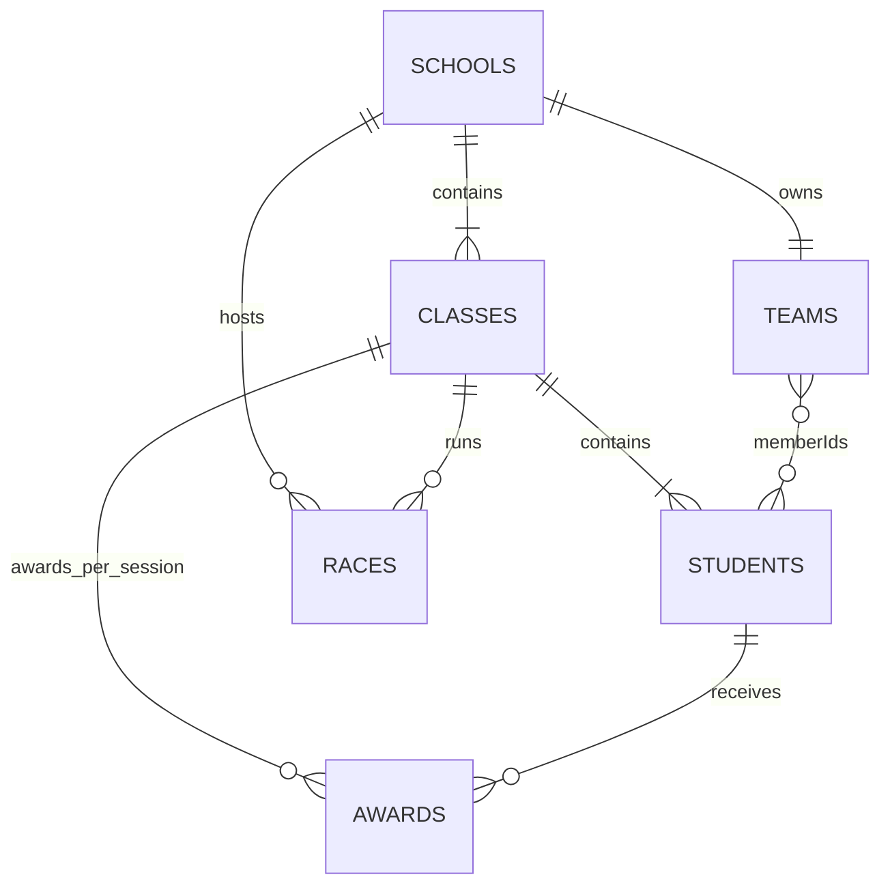

# Super Runners 資料結構

本文件說明目前前端讀取、暫存與匯出的遊戲世界資料。本機使用 IndexedDB，雲端使用 Firebase Realtime Database；固定資料優先從本機載入，動態資料依操作同步。完整雲端路徑、遷移、按需查詢與斷線補傳見 [雲端同步說明](cloud-sync.md)。

## 儲存位置與版本

- IndexedDB 資料庫名稱：`superrunners-taiwan-v3`
- 資料結構版本：`schemaVersion: 3`
- IndexedDB object store 版本：`3`，升級保留原有資料。
- 每個瀏覽器各自保有本機快取，同一帳號連結同一個雲端世界。
- 既有存檔首次連接時上傳至雲端。新的瀏覽器從雲端還原，不再重新隨機生成世界；有本機固定資料時不再重複下載。
- 舊版資料庫 `superrunners-taiwan-v1`、`superrunners-taiwan-v2` 會在啟動時清除。

資料庫使用一個 `meta` store、六個實體資料表與兩個同步資料表（其餘皆以 `id` 為 key）：

| Store | 用途 |
| --- | --- |
| `meta` | 世界設定、版本、收藏與追蹤清單等非表格資料 |
| `schools` | 全國國中與其班級資料 |
| `students` | 全國學生完整個人資料 |
| `teams` | 學校田徑隊及未來可擴充的代表隊 |
| `races` | 每一組百米賽的完成紀錄 |
| `awards` | 班級完整賽程完成後產生的前三名獎牌 |
| `windMeets` | 風速小子選拔賽的參賽名單、每輪對戰與歷屆冠軍 |
| `outbox` | 與本機變更一起保存的待同步動作；雲端確認後移除 |
| `cloudCache` | 排名等按需查詢的快照及更新時間 |

每次寫入會同時更新 `meta` 與受影響資料表，避免成績、個人最佳與獎牌只寫入其中一部分。

## 完整匯出 JSON

匯出檔案將 `meta` 與六個實體 stores 合併成一個 JSON 物件；`outbox`、`cloudCache` 不匯出。這是本機目前快照，不代表所有尚未瀏覽學校的動態資料都已重新讀取。結構如下：

```js
{
  schemaVersion: 3,
  schoolTeamSelectionVersion: 1,
  country: { code: 'TW', name: '臺灣' },
  createdAt: '2026-10-06T00:00:00.000Z',
  seed: 'superrunners-tw-115-v3',
  source: {
    name: '教育部學校名錄',
    note: '學校名稱為真實公開資料；學生、能力與成績皆為虛構。'
  },
  exportedAt: '2026-10-06T00:00:00.000Z',

  favoriteSchoolIds: [],
  followedTeamIds: [],
  settings: { muted: false },

  schools: [],
  students: [],
  teams: [],
  races: [],
  awards: [],
  windMeets: [],
  windChampions: {}
}
```

`exportedAt` 僅在匯出檔加入，不會寫回遊戲存檔。

完成雲端連接後，還會保存 `cloudBinding: { uid, worldId, databaseURL }`，避免錯誤帳號或不同世界互相覆寫。

## 關聯總覽



資料以 ID 連結，沒有巢狀複製整位學生資料。例外是 `races.results` 會保存學生姓名、學號、班級等當時快照，確保日後更改綽號或隊籍後，舊賽事紀錄仍保有當次資料。

## 世界中繼資料

| 欄位 | 型別 | 說明 |
| --- | --- | --- |
| `schemaVersion` | `number` | 儲存格式版本，目前為 `3`。版本不符時停止載入，避免錯誤覆蓋。 |
| `schoolTeamSelectionVersion` | `number` | 校隊初始選拔規則版本。 |
| `country` | `object` | 預設國家，目前為臺灣。 |
| `createdAt` | ISO 日期字串 | 此遊戲世界初次生成時間。 |
| `seed` | `string` | 初始隨機生成種子。 |
| `source` | `object` | 學校名錄來源說明。 |
| `favoriteSchoolIds` | `string[]` | 收藏學校 ID，可供校內比賽快速選擇。 |
| `followedTeamIds` | `string[]` | 顯示於「我的隊伍」的隊伍 ID。 |
| `settings.muted` | `boolean` | 背景音樂是否靜音。 |
| `windChampions` | `object` | 學校 ID → 年級 → 現任風速小子稱號與決賽成績。 |

## 學校與班級

### `schools[]`

```js
{
  id: 'school-id',
  name: '○○市立○○國民中學',
  city: '○○市',
  schoolNumber: 1,
  teamId: 'team-school-id',
  classes: [/* Class */]
}
```

學校基本欄位 `id`、`name`、`city` 來自學校名錄。每校固定三個年級；每個年級至少八班，班級數與班級學生數在世界初始化時確定並保留。

### `schools[].classes[]`

```js
{
  id: 'school-id-1-01',
  schoolId: 'school-id',
  grade: 1,
  number: 1,
  name: '一年級 1 班',
  color: '#...',
  studentIds: ['student-id-1', 'student-id-2']
}
```

| 欄位 | 說明 |
| --- | --- |
| `grade` | 年級數字 `1` 至 `3`，介面顯示為一年級、二年級、三年級。 |
| `number` | 班級序號。 |
| `color` | 班服上衣代表色，同班一致。 |
| `studentIds` | 此班學生 ID；每班初始化約 30 至 40 人，且不超過 50 人。 |

## 學生

### `students[]`

```js
{
  id: 'TPE0110101',
  studentNumber: 'TPE0110101',
  schoolId: 'school-id',
  classId: 'school-id-1-01',
  name: '王小明',
  nickname: '',
  gender: '男',
  grade: 1,
  age: 12,
  height: 154.3,
  weight: 46.8,

  explosiveness: 6,
  endurance: 5,
  stamina: 5,
  strength: 6,
  technique: 5,

  baseline100: 15.24,
  best100: null,
  isSchoolTeam: false,
  isCityTeam: false,
  isNationalTeam: false,
  ranks: { class: 0, grade: 0, school: 0, national: 0 }
}
```

| 分類 | 欄位 | 說明 |
| --- | --- | --- |
| 識別 | `id`, `studentNumber` | 目前相同，格式為縣市英文字母代碼、兩位校碼、年級、兩位班級、兩位座號。 |
| 所屬 | `schoolId`, `classId`, `grade` | 連結學校、班級與年級。 |
| 基本資料 | `name`, `nickname`, `gender`, `age`, `height`, `weight` | 名字、暱稱、性別、年齡及身體資料。身高單位為 cm，體重單位為 kg。 |
| 能力 | `explosiveness`, `endurance`, `stamina`, `strength`, `technique` | 每項為 1 至 10。 |
| 百米 | `baseline100`, `best100` | 預估百米秒數與實際最佳秒數。尚未參賽時 `best100` 是 `null`。排名與校隊選拔優先採實際最佳成績，否則採預估成績。 |
| 隊籍 | `isSchoolTeam`, `isCityTeam`, `isNationalTeam` | 是否為校隊、縣市代表隊、國家代表隊。 |
| 名次 | `ranks.class`, `ranks.grade`, `ranks.school`, `ranks.national` | 依百米成績計算的班級、年級、校內及全國排名。 |

學生實際參賽時會依能力與少量隨機性產生每次不同的秒數；保存一組成績後，若更快便更新 `best100` 並重算排名。

## 隊伍

### `teams[]`

```js
{
  id: 'team-school-id',
  type: 'school',
  name: '○○國中田徑隊',
  schoolId: 'school-id',
  city: '○○市',
  createdAt: '2026-10-06T00:00:00.000Z',
  memberIds: ['student-id-1'],
  awardIds: ['award-id-1']
}
```

目前每所學校初始化一隊 `type: 'school'` 的校隊。`memberIds` 是校隊成員，`awardIds` 是校隊成員獲得、且計入隊伍的獎牌。資料結構也預留給未來的縣市代表隊與國家代表隊，但尚未自動生成這兩種隊伍。

## 比賽紀錄

### `races[]`

每一筆 `races` 是一組最多八名選手的百米賽，不是一個完整班級賽程。校內班級賽以 `classId` 表示來源班級；隊內賽則設定 `classId: null`，並以 `teamId`、`teamName` 表示參賽隊伍。隊內賽每組只接受該隊名單中且具有相符隊籍身份的隊員，更新個人最佳與排名，不產生班級獎牌。

```js
{
  id: 'session-id-heat-1',
  sessionId: 'session-id',
  schoolId: 'school-id',
  classId: 'school-id-1-01',
  // 隊內賽使用 classId: null，並加上 teamId、teamName。
  teamId: null,
  teamName: null,
  schoolName: '○○國中',
  className: '一年級 1 班',
  classColor: '#...',
  heat: 1,
  event: '100m',
  startedAt: '2026-10-06T00:00:00.000Z',
  finishedAt: '2026-10-06T00:00:18.000Z',
  syncStatus: 'pending', // 本機 outbox 尚未收到雲端確認時才存在；不會上傳
  results: [/* RaceResult */]
}
```

### `races[].results[]`

```js
{
  studentId: 'student-id-1',
  lane: 1,
  time: 14.82,
  place: 1,
  personalBest: true,
  previousBest100: 15.04, // null 表示這是第一筆正式百米紀錄
  name: '王小明',
  nickname: '',
  gender: '男',
  height: 154.3,
  weight: 46.8,
  studentNumber: 'TPE0110101',
  schoolId: 'school-id',
  classId: 'school-id-1-01',
  className: '一年級 1 班',
  classColor: '#...',
  schoolName: '○○國中',
  dateTime: '2026-10-06T00:00:18.000Z'
}
```

`personalBest` 表示本次是否刷新（或首次建立）正式百米最佳；`previousBest100` 保存賽前最佳，用於總覽標記。

`id` 是單組唯一 ID；再次保存相同 ID 時，系統會直接保留既有紀錄，避免重複建立。`sessionId` 將同一場多組、同一班、全校自動賽或隊內賽串在一起。隊伍跨校時，每筆 race 的 `schoolId` 是雲端 `dynamic/races/{schoolId}/{raceId}` 的索引學校；各參賽者實際的 `schoolId`、`classId`、`schoolName` 與 `className` 則保留在個人成績中。

成績與待上傳操作會在同一個 IndexedDB 交易中保存。雲端確認前，該組紀錄帶有本機欄位 `syncStatus: 'pending'` 並顯示「本機待同步」；上傳成功並確認本機交易後，欄位會移除。此欄位只用於本機提示，不屬於 Realtime Database 的比賽資料。

## 獎牌

### `awards[]`

當某班所有學生均已跑完該次 `sessionId` 的百米賽，系統依該班所有組別的秒數選出前三名並建立獎牌。

```js
{
  id: 'session-id-class-id-medal-0',
  sessionId: 'session-id',
  schoolId: 'school-id',
  classId: 'school-id-1-01',
  studentId: 'student-id-1',
  studentName: '王小明',
  studentNumber: 'TPE0110101',
  schoolName: '○○國中',
  className: '一年級 1 班',
  classColor: '#...',
  year: 2026,
  dateTime: '2026-10-06T00:00:18.000Z',
  event: '100m',
  competition: '校內百米・一年級 1 班',
  type: 'individual',
  medal: '金牌',
  place: 1,
  time: 14.82
}
```

`medal` 為 `金牌`、`銀牌` 或 `銅牌`；每個班級、每個賽程只會建立一次前三名獎牌。

## 全校與全國校內自動百米賽的暫存狀態

兩種自動百米賽共用前端記憶體中的 `autoMeet` 控制器，可在應用程式內切換首頁、學校資料或我的隊伍後持續進行。`scope: 'school'` 只安排指定學校；`scope: 'national'` 依臺北市、新北市及學校選單中的其餘縣市順序，逐校完成各自的校內賽。同縣市按教育部學校代碼排序，每校依一年級至三年級、班級號碼、組別順序參賽。

```js
{
  active: true,
  scope: 'national', // school | national
  runId: 'auto-uuid',
  schoolIds: ['school-id', 'next-school-id'], // 已排序的參賽學校，不更動世界資料
  schoolIndex: 0,
  schoolId: 'school-id',
  sessionId: 'auto-uuid-school-id', // 每校獨立，獎牌仍按該校各班產生
  queue: [/* 只有目前學校，依一年級至三年級、每班、每組排序的 heat */],
  heatIndex: 0,
  completedSchools: 0,
  completedHeats: 0,
  completedClasses: 0,
  completedStudents: 0,
  totalHeats: 123, // 此輪所有參賽學校的組數，依實際班級人數計算
  phase: 'countdown', // idle | countdown | running | saving | saveerror | complete
  athletes: [/* 當前組選手與跑步 profile */],
  elapsed: -3,
  paused: false,
  speed: 16,
  startedAt: '...',
  finishedAt: '',
  error: ''
}
```

每組成績完成本機交易後才增加完成數、進入下一組；每校最後一組保存後才換校。每組沿用 `recordHeat()` 寫入成績、個人最佳、獎牌及雲端 outbox，並維持相同重試 ID。全國模式只保留學校 ID 清單與目前學校的組別，不額外建立包含全國學生的巨大賽程陣列。全國自動賽新開賽時預設 `speed: 16`，單校自動賽仍預設 `speed: 1`；暫停與播放速度在換組、換校時延續。最後一校完成後顯示校數、班數、人數及組數總結，返回比賽選單才關閉此完成畫面。

兩種模式均由 `meet-clock.js` 計算實際經過時間：前景使用動畫畫格維持順暢顯示，背景另由 `meet-clock.worker.js` 每 250ms 喚醒控制器。切換其他軟體或瀏覽器分頁不會呼叫手動暫停；若瀏覽器延遲喚醒，保留的時間會依序推進倒數、完賽及減速，跨組、跨校時仍等待每組本機交易完成，不會丟掉超過一個畫格或一組的時間。Worker 同時只保留一個待回覆訊息，避免背景累積大量訊息。

時鐘的待處理區間只保存在記憶體，每段包含單調時間的起點、終點及當時播放倍率。調速只影響之後的區間；暫停、登出及存檔錯誤停止累積時間，繼續或成功重試後才恢復。完賽日期使用實際跨過終點的區間時間，背景追趕時不會全部記成回到網頁的時間，也不補播過時的倒數音效。畫面重繪與背景訊息共用同一時鐘及單一保存流程，不會重複推進或存檔。

瀏覽器或作業系統完全凍結頁面時，前端無法當下執行及寫入成績；恢復執行後會處理時鐘可量測到的經過時間。

`world.autoMeetProgress` 是 IndexedDB 專用的暫存欄位，保存全國／全校自動賽的目前學校、組別、完成計數、速度與暫停狀態。每組成功寫入本機成績後更新，完成整場或手動終止後清除。它不會放進匯出 JSON，也不會傳到 Realtime Database。重新整理、重新開機或遇到網路中斷後，世界載入完成會依此欄位自動從最後一組已保存的位置繼續；尚未完成的當前組會重新產生一次，固定 race ID 會避免重複紀錄。

`world.cancelledAutomaticMeetRunIds` 只保存在 IndexedDB，記錄已手動終止的全國賽 run ID，避免啟動時從既有已完賽紀錄推算進度而重新啟動已取消賽程。終止會清除剩餘排程與 `autoMeetProgress`；已完成並保存的組別及個人最佳仍保留。此欄位不會匯出或同步到雲端。

固定世界保存在 IndexedDB `superrunners-taiwan-v3`。啟動時會向瀏覽器申請持久化儲存，降低大型學生資料集被瀏覽器自動回收的機率；若瀏覽器拒絕，仍會正常使用 IndexedDB，但瀏覽器可能在儲存空間不足時清除資料。`localhost`、`127.0.0.1`、Firebase Hosting 網址及不同連接埠屬於不同來源，各自擁有獨立的 IndexedDB，必須固定使用同一個網址才能看到同一份本機資料。

自動賽控制器本身在頁面記憶體，但進度由 `world.autoMeetProgress` 保存到 IndexedDB；重新整理後會續跑最後已保存的組別。手動終止全國賽時，時鐘停止、剩餘組別排程與進度清除，並將 run ID 加入本機取消清單。已完成並寫入 `races` 的組別、已更新的個人最佳成績與已產生的獎牌則會保留。

## 本機與雲端的對應

本機維持目前的 `schools`、`students`、`teams`、`races`、`awards` 物件，雲端拆為固定 `static`、動態 `dynamic` 與四種 `rankings` 索引，仍使用相同 ID 關聯。收藏、關注以 UID 隔離；音樂靜音設定仍屬於各瀏覽器的本機設定。完整對應見 [雲端同步說明](cloud-sync.md)。

## 風速小子選拔賽與稱號

IndexedDB object store 版本 3 新增 `windMeets`，原有資料表及世界 `schemaVersion: 3` 保留。升級只新增空資料表，不重新生成或下載固定學生資料。

`world.windMeets` 是各屆選拔賽，`id` 同時是該屆的 `sessionId`：

```js
{
  id: 'meet-uuid', schoolId: 'school-id', schoolName: '示例國中',
  status: 'running', // 完賽為 complete
  startedAt: '2026-10-14T01:00:00.000Z', finishedAt: null,
  paused: false, completedMatches: 0, totalMatches: 27,
  grades: [{
    grade: 1,
    entrants: [{ classId: 'class-id', className: '一年級 1 班', classNumber: 1,
      studentIds: ['student-a', 'student-b', 'student-c'] }],
    rounds: [{ number: 1, matches: [{
      id: 'meet-uuid-g1-r1-m1', grade: 1, round: 1, number: 1,
      classIds: ['class-a', 'class-b'], classNames: ['一年級 1 班', '一年級 2 班'],
      studentIds: ['a1', 'a2', 'a3', 'b1', 'b2', 'b3'],
      status: 'pending', // done 完賽；bye 輪空
      winnerClassId: null, winnerStudentId: null, winnerName: null,
      winnerTime: null, raceId: null
    }] }],
    champion: null
  }]
}
```

每班前三名按「有效個人最佳，否則預估百米」排序，在本屆開賽時固定。每輪配對兩班，每場最多六人；第一名所屬班級晉級，單數班級輪空。百分之一秒相同時採跑道次序決勝；各年級獨立產生冠軍。

正式比賽紀錄 `races` 的 `mode` 為 `wind-selection`，帶有 `classIds`、`windMatchId`、`grade`、`round`，`classId` 為 `null`；結果快照仍含每位學生自己的 `classId`、班級名稱、學號、秒數與日期。選班後的前三名練習為 `wind-practice`，最多八人一組，不產生稱號或班級獎牌，仍更新個人最佳。

跨班比賽的角色上衣與人物卡代表色，取自每位學生所屬班級的 `color`。歷程總覽直接由 `grades[].rounds[].matches` 建立淘汰樹，第一輪在底部、冠軍在頂部；贏者節點顯示 `winnerName`、得勝班級與 `winnerTime`。第一輪節點下方只列對戰兩班名稱，不顯示參賽學生姓名。前輪第 `i` 場（從 0 起算）連到下一輪第 `Math.floor(i / 2)` 場。輪空顯示「輪空」與空成績，不另存畫面座標，也不變更既有比賽資料。

`world.windChampions` 存在 meta，索引為 `{ [schoolId]: { [grade]: champion } }`，champion 包含 `studentId`、`name`、`classId`、`className`、`grade`、`time`、`awardedAt`、`meetId`。每校每年級一位現任風速小子，新一屆該年級決賽完成時取代；舊冠軍仍保存在原屆 `grades[].champion`。學生資料本身不另外複製 boolean，畫面以此索引顯示稱號。

每場比賽、個人最佳、對戰樹及決賽稱號於同一 IndexedDB transaction 保存。全部內容納入 JSON 匯出與雲端待同步。重整後找出本機尚在 `running` 的選拔賽，從最後保存的下一場對戰恢復；為方便確認進度，預設先暫停，按「繼續」即可起跑。被中斷而尚未完賽的一場會重新起跑。
